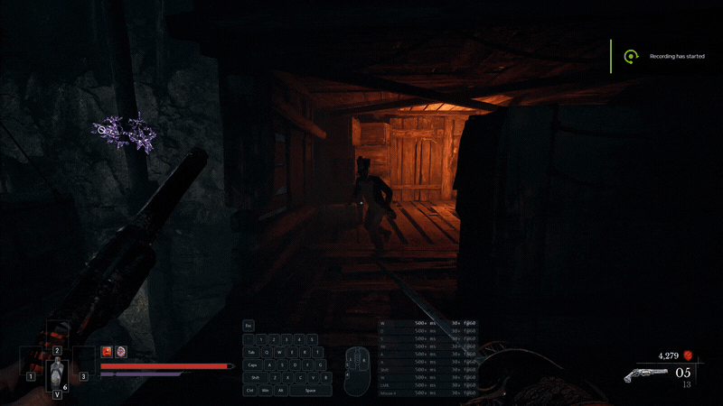
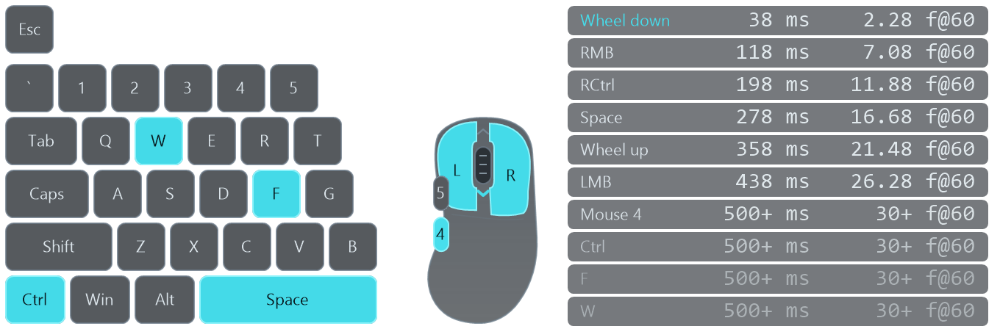
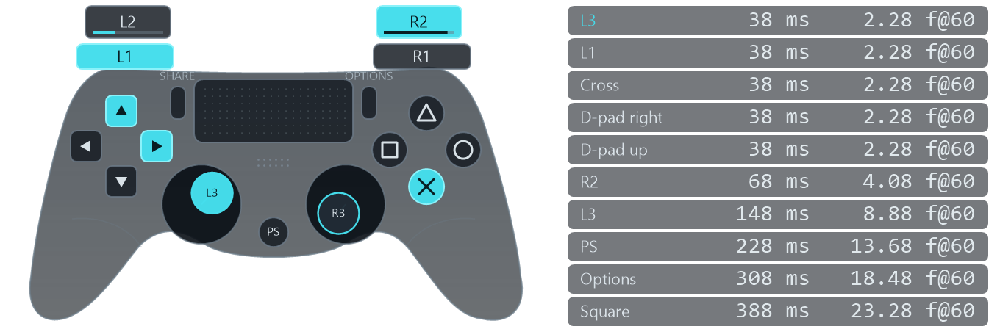
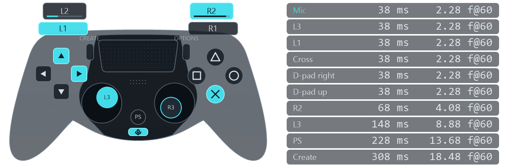
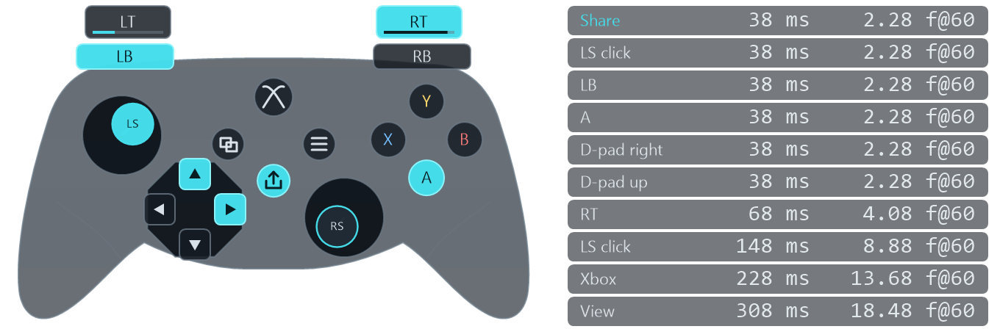

# Input Overlay

Input Overlay displays your keyboard, mouse, PlayStation, or Xbox controller inputs over your game. Pressed buttons light up, and a history of your last 10 inputs helps you follow a sequence and see when each press happened.

The overlay is transparent, stays above windowed or borderless games, and lets mouse clicks pass through without taking focus from your game.

**Tap <kbd>Num 0</kbd> (Numpad 0) to hide or show the overlay at any time.** It works while you're in a game and with Num Lock either on or off, so you can clear the screen and bring it back without switching windows. This shortcut works in all four overlays.

## Releases

Download Windows x64 builds from the [latest release](https://github.com/pre-alpha-final/input-overlay/releases/latest).

Downloads for [v1.1.0](https://github.com/pre-alpha-final/input-overlay/releases/tag/v1.1.0):

| Overlay | Download |
| --- | --- |
| Keyboard and mouse | [InputOverlayMnK](https://github.com/pre-alpha-final/input-overlay/releases/download/v1.1.0/InputOverlayMnK-1.1.0-win-x64.zip) |
| PS4 / DualShock 4 | [InputOverlayPS4](https://github.com/pre-alpha-final/input-overlay/releases/download/v1.1.0/InputOverlayPS4-1.1.0-win-x64.zip) |
| PS5 / DualSense | [InputOverlayPS5](https://github.com/pre-alpha-final/input-overlay/releases/download/v1.1.0/InputOverlayPS5-1.1.0-win-x64.zip) |
| Xbox Series X\|S | [InputOverlayXbox](https://github.com/pre-alpha-final/input-overlay/releases/download/v1.1.0/InputOverlayXbox-1.1.0-win-x64.zip) |

Install the runtime listed under [Requirements](#requirements), extract the ZIP,
and run the matching `.exe`. Keep all extracted files together.

## Requirements

Windows x64 and the [.NET 10 Desktop Runtime](https://dotnet.microsoft.com/en-us/download/dotnet/10.0)
are required to run the overlays. On the download page, choose the **Windows x64**
installer under **.NET Desktop Runtime** and install it before running an overlay.

## Overlays

### Keyboard and mouse

A compact keyboard layout, five mouse buttons, and scroll-wheel activity. The input history also shows keyboard presses outside the visible layout.

### PS4 / DualShock 4

Supports Sony DualShock 4 v1 and v2 controllers over USB or Bluetooth. Shows buttons, the D-pad, stick movement and clicks, and L2/R2 trigger pressure.

### PS5 / DualSense

Supports the standard Sony DualSense controller over USB or Bluetooth. Shows buttons, the D-pad, stick movement and clicks, trigger pressure, Create, and Mic presses.

### Xbox Series X|S

Shows A/B/X/Y, the D-pad, offset sticks and clicks, LT/RT pressure, LB/RB, View, Menu,
Xbox and Share using Microsoft GameInput. Supports USB, Bluetooth and the Xbox Wireless
Adapter through Windows' controller drivers.

## Capture in OBS

1. Start the overlay and leave it visible.
2. In OBS, choose **Sources > + > Window Capture** and select `InputOverlayMnK`,
   `InputOverlayPS4`, `InputOverlayPS5`, or `InputOverlayXbox` from the **Window** list.
3. Set **Capture Method** to **Modern (WGC)** (called **Windows 10 (1903 and up)**
   in older OBS versions) and turn off **Capture Cursor**.
4. Place the Window Capture source above your game source in the **Sources** list.

The overlay stays click-through on your desktop. If it is missing from the Window
list, press Numpad 0 to show it before opening the source properties.
Numpad 0 hides the overlay on both your desktop and in OBS. Press it again to
restore the overlay in the same position without switching away from your game.

## Adjust size and position

| Option | What it does | Default |
| --- | --- | --- |
| `--scale N` | Resize the overlay, from `0.5` to `3`. | `1` |
| `--bottom-margin N` | Distance from the bottom of the screen, from `0` to `1000` display-independent pixels. | `24` |
| `--monitor N` | Use a monitor number shown by `--list-monitors`. | Primary monitor |
| `--list-monitors` | List available monitors and exit. | |
| `--help` | Show command-line help and exit. | |

## Read the input history

The newest press appears at the top, with up to 10 entries visible. Each row shows the time since the app received that press in milliseconds and an approximate 60 fps time equivalent (`~f@60`). The equivalent starts at 1 for a new press: 100 ms corresponds to `~7 f@60`, or six elapsed 60 fps frame intervals.

The frame equivalent uses the full timestamp precision, while the millisecond display truncates fractions. Neither value counts game or recording frames. On the primary display, animation redraws follow Windows desktop composition timing when it is available; other displays use a steady clock at their reported refresh rate. Redraws still run independently of the game and recorder, so a recorded timer can be older than the game image beside it. For animation or parry frame counts, step through the game footage.

Timers stop at `500+ ms` / `~31+ f@60` and dim, but entries stay visible until newer presses replace them. Releasing a button does not add a row. Controller stick movement and changes in trigger pressure do not add rows either; trigger button presses do.

## Controller notes

- The first accessible supported controller is selected. If it disconnects, the controls return to neutral, the history stays visible, and the overlay reconnects automatically when a supported controller becomes available.
- Both sticks have a 10% circular deadzone to suppress resting drift. Trigger pressure is displayed without a deadzone.
- If a controller is missing, check whether another application has hidden it or opened it exclusively. The PlayStation overlays need shared access to the physical controller; Xbox input comes through GameInput.

For more controller-specific details, see the [PS4 README](src/InputOverlayPS4/README.md), [PS5 README](src/InputOverlayPS5/README.md), or [Xbox README](src/InputOverlayXbox/README.md).

## License

[MIT](LICENSE).
